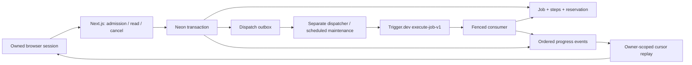

# Durable jobs and Pro billing foundation

Status: development/test foundation, 1 November 2026. Production remains off.
The only registered workflow is `execution-check-v1`: three non-billable system
checkpoints. Deep Research's iterative evidence loop and browser-agent actions
are **not implemented or sold** by this change. FAST research is unchanged.

## Execution boundary

Admission checks the current verified, non-anonymous identity and a captured TEST
billing period. A unique owner/request pair and fingerprint make client retries
idempotent. One active job per owner is enforced in PostgreSQL. Job concurrency
is separate from FAST concurrency; both use the same operator-budget table and
ascending bucket lock order. Sandbox checks reserve zero provider dollars.

A single transaction reserves a paid-period job slot, reserves the reviewed
manifest's maximum provider cost in operator DAY/PERIOD rows, inserts the job and
all step identities, appends QUEUED, and inserts the outbox. FKs bind the owner to
the captured subscription period and each reservation to the operator namespace
and correct window kinds. No provider/network call runs inside these locks.

The dispatcher leases outbox records and sends a stable `job:id:dispatch:revision`
idempotency key. A crash before acknowledgment redelivers the same key. A lost
acknowledged delivery with no consumer is recovered with a new dispatch revision.
Transport delivery is at least once; execution claims are protected independently
by the database. Only the matching development namespace is consumed or recovered.

Workers hold a generation and a short lease. Each immutable step key/cap can be
claimed once per generation; a successful checkpoint is skipped on replay. Every
step boundary/heartbeat checks the lease, absolute deadline and current paid
period. A terminal transition and accounting receipt commit together. Cancel is
an owned, persisted transition, not browser disconnection. Late workers cannot
publish progress or completion after cancellation. Closing/reloading a tab does
not cancel work. Progress uses bounded polling with a persisted monotonic cursor,
not an in-memory stream. Events contain only reviewed neutral codes/step keys.

On a lost lease, only pure SYSTEM work with a zero cap can restart. A STARTED
billable/unknown step terminates the job conservatively and leaves its maximum
possible cost held in **both** original operator windows. Known spend settles
once. Expiry, cancellation and replay never erase those holds. This PR does not
add an operator cost-resolution UI or any billable executor: reviewed provider
receipts/resolution tools are required before those adapters can ship.

The execution check has a two-minute absolute deadline, a 15-second lease and
three three-second simulated checkpoints. These limits are a test manifest,
not the future Deep Research search/token quota. Cancellation after work starts
consumes one test check; cancelling a still-queued check releases its slot.

## Razorpay boundary

The owner selected **Pro: ₹999/month**. This implementation accepts only
`rzp_test_` keys, a server-allowlisted monthly INR 99,900-paise plan, quantity one,
and a server-owned subscription. Test cycles grant ten execution checks. Live
Deep Research/Tasks allowances, taxes/refund policy and feature delivery need
separate release decisions; this is not an unlimited ₹999 research offer.

Checkout preparation commits before the one provider create attempt. If create
is ambiguous, its CREATING/UNKNOWN record blocks another subscription. Maintenance
can bind a unique provider subscription by the stored checkout notes; a missing
or ambiguous match remains blocked for operator attention. It never blindly
repeats subscription creation. Provider reads are bounded and reconciliation is
idempotent. Job dispatch/recovery has priority over billing maintenance.

Browser callback HMAC uses `payment_id|server_stored_subscription_id`. Neither a
valid mandate signature, activation event nor UI success grants access by itself.
The server fetches the pinned subscription, its scoped invoices and captured
payment. It checks plan/quantity/notes, invoice/payment identity, amount, currency,
refund amount and the invoice's own billing start/end. It never uses the current
subscription window to credit a historical renewal. One payment/invoice grants
one period. TEST periods cannot become LIVE periods.

The webhook verifies raw bounded bytes before JSON parsing, stores a durable
content-minimized inbox receipt and deduplicates event ID/body hash. Processing
has leases and bounded retries; exhausted records remain ATTENTION. Signed
refund/dispute tombstones revoke access atomically and prevent delayed charge
messages from restoring it. Renewal cancellation preserves already-paid coverage.
Every worker step checks revocation. `after()` only accelerates inbox processing;
the separate worker also drains it and reconciles provider records.

Only provider references, ownership, lifecycle, period dates and counters are
stored. Customer/card/contact details, raw webhook bodies and API secrets are not
stored in these tables. Checkout is loaded only on user action. Financial audit
records are retained; account-wide billing erasure/export policies require review
before live billing. No autonomous browser task or irreversible action is enabled.

## Local setup

Use the pinned Node/pnpm versions and `pnpm install --frozen-lockfile`. The Trigger
CLI lives in a tiny workspace with TypeScript 5 to satisfy its declared peer;
the Next application retains TypeScript 6 and strict peer validation. Patched CLI
transitives are pinned; no audit gate is disabled.

1. Apply migrations 0025–0027 to the **development** Neon database, then apply
   `scripts/runtime-grants.sql` as the development owner. New snapshots remain
   immutable to runtime UPDATE grants. Migration 0027 backfills reservation keys
   and creates referenced unique indexes before its compound FKs.
2. Set `ENABLE_DURABLE_JOB_SANDBOX=true` and a `JOB_OPERATOR_BUDGET_KEY=test-…`
   namespace in ignored `.env.local`. It must reference bounded DAY/PERIOD operator
   rows. The verified sandbox has a separately provisioned **zero-dollar** window;
   it does not raise/reset any OpenRouter/FAST budget. Expired windows fail closed.
3. Set test Razorpay ID/secret, the approved test `RAZORPAY_PRO_PLAN_ID`, an independent
   `RAZORPAY_WEBHOOK_SECRET`, and `ENABLE_RAZORPAY_TEST_CHECKOUT=true`. Use a saved
   existing test secret; do not regenerate shared project keys. Set the Trigger
   development API key locally. Never put any secret in `NEXT_PUBLIC_*` or Git.
4. Copy only the required worker values into ignored `.env.jobs.local`, using
   [the minimal template](job-worker.env.example). This file intentionally omits
   Google, Better Auth and OpenRouter/Tavily secrets.
5. `pnpm dev` runs the web app on port 3000. `pnpm jobs:dev` registers the two tasks
   with Trigger Development and runs their consumer locally; `pnpm jobs:dispatch`
   separately drains the persisted outbox. The UI does not depend on either
   process staying attached to an HTTP request.
6. Without Trigger, use **only** `pnpm jobs:worker` as the explicit local consumer.
   Both adapters use the same engine. `--once` is available for process tests.
7. Visit `/billing` for TEST checkout, then `/jobs`. An authenticated browser
   callback grants access only after verified capture. No paid inference is made.

The current guards explicitly reject Vercel production and any database other
than the pinned development Neon host. Setting a flag cannot open these features
against production. A staging cron adapter is defined but **not deployed or
verified as hosted scheduled recovery** by this PR. The existing FAST production
recovery schedule is separate and unchanged.

The provider webhook cannot reach localhost. Hosted HTTPS delivery, provider
webhook registration/retry, scheduler downtime/recovery and a reviewed production
worker environment are still release gates. Do not infer them from local signed
HTTP tests or successful development task registration.

## Verification evidence

- PGlite: strict public contracts, active-owner/intent uniqueness, compound owner
  and budget FKs, restricted snapshot grants, atomic admission, dispatch fencing,
  checkpoint replay, cancellation, expiry and retained unknown-cost holds.
- Billing: forged/altered signatures, duplicates/body mismatch, wrong plan/currency/
  amount/capture, cancellation, refunded/late events, ambiguous create and a new
  verified account without prior conversation history.
- Real development PostgreSQL: three final cases passed in 58.89 seconds (earlier run: 70.55 seconds), including
  simultaneous independent connections, an actual separate-process crash/restart
  and durable cancellation. Captured fixture rows and zero-dollar namespace were
  cleaned. Log: `.artifacts/durable-jobs-neon-final.log` (private, ignored).
- Real in-app browser: unpaid denial; actual Razorpay TEST ₹999 capture; verified
  ten-check entitlement; reload before/during managed execution; full completion
  and persisted cancellation; desktop/mobile layout; renewal cancellation retaining
  paid access. Trigger Development visibly registered both tasks and consumed jobs.
- Four final desktop/mobile regression cases pass in 2.7 minutes, including
  signed local HTTP webhook replay/forgery checks and full-page accessibility.
- Browser inspection found a locale-dependent hydration mismatch. Dates now use
  an explicit locale/timezone. Browser test selector mistakes remain recorded in
  the initial local logs; they do not count as passing test runs.
- Final whole-suite/build/browser/audit results and the PR are recorded in
  [the release checklist](release-checklist.md). Local `.artifacts` screenshots,
  traces, logs and provider references are not public CI uploads.

No OpenRouter/Tavily inference/search requests were needed. The existing $2 total
OpenRouter cap, key expiry, production operator/account ceilings and unknown holds
remain unchanged. Razorpay tests moved no real funds. No production migrations,
worker deployment or live checkout activation were performed.

## Sources

- Installed Next 16.4.2 route, environment, `after`, client-boundary and Playwright guides.
- [Trigger task overview](https://trigger.dev/docs/tasks/overview),
  [triggering](https://trigger.dev/docs/triggering),
  [scheduled tasks](https://trigger.dev/docs/tasks/scheduled),
  [configuration](https://trigger.dev/docs/config/config-file).
- [Razorpay subscription integration and callback signature](https://razorpay.com/docs/payments/subscriptions/integration-guide),
  [subscription creation](https://razorpay.com/docs/api/payments/subscriptions/create-subscription),
  [scoped invoices](https://razorpay.com/docs/api/payments/subscriptions/fetch-invoices),
  [raw webhook verification](https://razorpay.com/docs/webhooks/validate-test).
