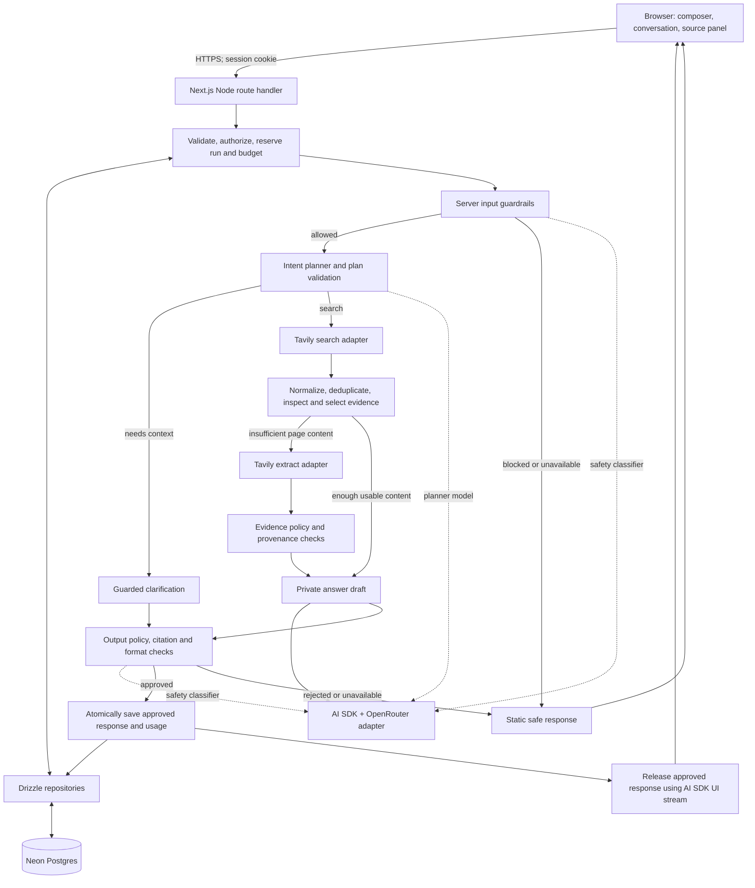
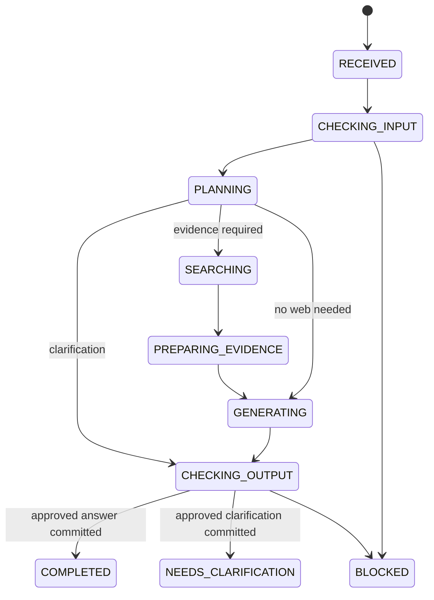

# Perplex: system design

Date: 2026-10-22. Status: proposed architecture for implementation, revised to include anonymous trials, concrete authentication, model selection and Indian payments.

This is a design for a production-oriented, Perplexity-style web answer application, not a claim about Perplexity's private infrastructure. Implementation has begun: Next.js, Neon/Drizzle and Google sign-in are working. [The foundation verification record](foundation-verification.md) separates implemented behavior from the larger target. No production deployment exists yet.

## 1. Product contract and assumptions

The user asks a question, receives either a useful clarification or an answer grounded in retrieved web evidence, can inspect citations, and can continue the conversation. Server-side input and output guardrails are required from the first live AI integration.

Assumptions:

- One developer or a small team; one TypeScript repository and one Next.js deployment initially.
- Next.js App Router, Vercel AI SDK, OpenRouter, Tavily, Neon Postgres and Drizzle ORM are the fixed core stack.
- Private, owned conversations for both anonymous trial sessions and registered accounts. Anonymous usage, tiered model selection and payments are now in scope; uploads, autonomous actions and public sharing remain deferred.
- Fast search first. Deep research is a later, explicitly enabled mode with a durable execution requirement.
- Strict output release: a complete answer is checked before any of its text, titles, source snippets or generated links reach the browser.
- Better Auth with Drizzle/Neon database-backed sessions, Google sign-in and the anonymous plugin is the concrete authentication choice. Session policy: 7-day rolling validity, renewal after 24 hours of eligible activity, a separately enforced 30-day absolute lifetime and 10-minute freshness for sensitive actions. See [authentication.md](authentication.md).
- Razorpay is the proposed first payment integration for an India-based seller serving mainly Indian customers; Cashfree is an alternative. Plans, model access, credit accounting and verified webhook activation are defined in [billing-and-entitlements.md](billing-and-entitlements.md).
- Node.js runtime for AI/database routes. Hosting in a region near Neon. Vercel is the proposed host, but request-duration and concurrency limits must be verified for the actual plan.

Success means correct behavior under ambiguous requests, malicious content, concurrent retries, provider errors, cancellation and reload—not only a convincing happy-path answer.

Deferred: independent model-answer voting, a self-built crawler/index, persistent embeddings, microservices, Kafka, Kubernetes and multi-region writes. Revisit when measurements identify a need.

Scale is intentionally excluded from this learning project's goals. Use Postgres for authoritative quotas and billing ledgers and keep reconciliation as small scheduled application jobs. Security, observability, lifecycle correctness and recovery remain requirements at low traffic.

## 2. How components connect



The route is the composition boundary, not the place for every prompt, SQL query and policy rule. Application modules are ordinary server-side TypeScript functions. Only the browser crosses the HTTP application boundary.

Next.js Route Handlers provide request/response endpoints in the App Router. Use Server Components for authenticated initial conversation loading and Client Components for the composer and live response state. ([Next.js Route Handlers](https://nextjs.org/docs/app/getting-started/route-handlers))

AI SDK integrates with OpenRouter through its provider adapter. Keep upstream model IDs and capability requirements in server configuration. The UI may submit only an application `modelKey`, independently checked against server entitlements and the curated catalog. ([OpenRouter AI SDK integration](https://openrouter.ai/docs/guides/community/vercel-ai-sdk))

## 3. Request lifecycle

1. **Preflight:** enforce body-byte limit before expensive parsing, validate the request schema, verify registered/anonymous session and origin, authorize conversation ownership and check cheap rate limits. Reject browser-supplied assistant messages, system prompts, user IDs, upstream model IDs or safety flags. Resolve the submitted application `modelKey` through the entitled catalog.
2. **Admit atomically:** claim a stable client idempotency key, compare the payload fingerprint, reserve customer answer credits separately from internal provider spend, enforce current tier/model/attempt limits and one active run per conversation, and check the expected conversation revision. Store a run without raw request text until input is accepted.
3. **Check input:** deterministic rules first, then semantic policy classification using the newest user text plus bounded relevant server-loaded context. A rejected request does not reach planning, Tavily or the answer model.
4. **Load/accept context:** store the allowed original user message. Load a token-bounded conversation tail and any approved summary. Prior assistant text is conversational context, not fresh web evidence.
5. **Plan:** return a validated clarification or intent-preserving search plan. Check newly generated search queries against policy before sending them to Tavily.
6. **Clarify when necessary:** safety-check and save one focused clarification question; end the run as `NEEDS_CLARIFICATION`. No Tavily call or answer draft is needed. The user's clarification starts a new run linked to this one.
7. **Retrieve:** execute only admitted search queries within concurrency, result-count, time and cost budgets. Extract additional content only when existing passages are insufficient.
8. **Select evidence:** reject malformed/unusable results, deduplicate sources, inspect for injection, rank passages and freeze the context package. Preserve contradictory credible sources rather than quietly dropping disagreements.
9. **Draft privately:** use one answer model with the original question, validated plan and evidence package. Keep the complete draft in server memory. Never merge a raw provider stream into the browser stream.
10. **Approve:** check safety, secret leakage, citation references, allowed link schemes, format and answer length. Optional deeper verification compares claims against evidence. If any required check is unavailable or malformed, fail closed.
11. **Commit then release:** a short transaction saves only the approved response, citation mapping, terminal run state and usage settlement. Return that committed response to the browser. A reload can recover it if delivery is interrupted.
12. **Observe:** record stage durations, verdicts, provider request IDs, token usage and failures without logging raw prompts, evidence or drafts by default.

No external API call happens inside a database transaction. No unapproved response is recoverable through history, polling, logs or an alternate endpoint.

## 4. Query understanding: clarify intent, not just expand text

A longer prompt is not necessarily a better query. Separate four things:

- **Original text:** the user's immutable request.
- **Standalone question:** a concise resolution of pronouns and follow-ups using authorized conversation context.
- **Search queries:** short retrieval queries, often different from the standalone question.
- **Answer instructions:** application-controlled instructions for synthesis and citations.

Never replace the original question with a model-written question and treat it as the new source of truth. Supply both the original and the validated interpretation to the answer model.

### Planning contract

The following is an application contract to implement with runtime schemas, not installed SDK code:

```typescript
type Constraint = {
  name: string;
  value: string;
  sourceMessageId: string;
};

type QueryPlan =
  | {
      action: 'CLARIFY';
      question: string;
      reasonCode: 'MISSING_ENTITY' | 'MISSING_CONSTRAINT' | 'AMBIGUOUS_REFERENCE';
    }
  | {
      action: 'ANSWER';
      standaloneQuestion: string;
      intent: 'EXPLAIN' | 'FACT' | 'COMPARE' | 'RECOMMEND' | 'RESEARCH';
      explicitConstraints: Constraint[];
      disclosedAssumptions: string[];
      retrieval: {
        required: boolean;
        queries: string[];
        freshness: 'ANY' | 'RECENT' | 'SPECIFIC_RANGE';
        startDate: string | null;
        endDate: string | null;
      };
      answerLanguage: string;
    };
```

Use schema-constrained structured output and validate it at the model boundary. AI SDK documents structured generation through `generateText`/`streamText` with an output schema; check the installed major's exact API before implementing. ([Structured data](https://ai-sdk.dev/docs/ai-sdk-core/generating-structured-data))

Planner rules:

1. Resolve entities from the bounded conversation; otherwise clarify. Do not hallucinate which product “it” refers to.
2. Preserve names, negations, dates, budgets, locations and user exclusions. Each claimed explicit constraint must point to an actual message in the same conversation; verify that message exists and supports it.
3. Do not invent deployment scale, programming language, audience, budget or geographic preferences. Low-impact assumptions may be disclosed; material missing constraints require clarification.
4. “Explain photosynthesis” deserves a broad explanation. It does not require an interview or an invented advanced research brief.
5. Generate at most the server-configured query limit. The model cannot raise budgets, select models, disable guardrails or authorize tools.
6. Only apply freshness restrictions when the request or topic requires them. Inject the current date and user timezone as server metadata for relative-date interpretation.
7. Keep planning output concise and inspectable. Store reason codes and selected assumptions, not private chain-of-thought.
8. Search is the default for information-seeking requests. Greetings and rewriting user-provided text can skip it; the UI must not label these as web-grounded answers.

Examples:

| Request and context | Decision | Retrieval behavior |
| --- | --- | --- |
| “Explain how RAG works” | Answer a general explanation; preserve scope | One or two focused conceptual queries |
| “Which database is best?” with no app context | Ask what kind of application/workload it serves | No search yet |
| “What about its pricing?” after discussing Neon | Resolve to Neon pricing | Search current official pricing; do not assume currency or tier |
| “Compare Neon and Supabase for a Next.js app” | Compare stated dimensions; disclose unspecified workload | Separate queries for relevant capabilities and pricing |
| “Why is product X always unreliable?” | Preserve the user's concern; investigate whether evidence supports it | Neutral queries that do not assume the accusation is true |

A planner timeout can fall back to the original query only for a standalone, unambiguous allowed request. An unresolved follow-up must clarify or fail; never guess. A model-reported confidence number alone is not a release or clarification criterion.

## 5. Input, retrieval and output guardrails

The detailed policy and decision contract are in [safety-policy.md](safety-policy.md). There are four enforced boundaries:

- **Before task models:** validation, auth, quotas, deterministic abuse/secret checks and semantic safety classification.
- **Before retrieval:** validate planner output and check the actual outbound search text. Redact accidental secrets before any allowed external forwarding.
- **Before synthesis:** validate Tavily payloads, inspect evidence for injection, preserve provenance and exclude unsafe or unusable material.
- **Before release:** inspect the complete answer, citations and visible metadata; release only an approved immutable response.

“Before the LLM” has two meanings. Deterministic checks run before any model. Semantic detection uses a safety classifier, which may itself be a model; it runs before the planner and answer model. For this stack, begin with a separate `MODEL_SAFETY` role through an isolated OpenRouter adapter, no tools, strict schema and a short timeout. A dedicated moderation endpoint or locally hosted classifier can later implement the same interface. Classifier accuracy must be evaluated; this design does not promise perfect harmful-content detection.

Do not use keyword bans as the entire safety system. A request to explain phishing prevention is different from a request to steal credentials. Version the policy, test both harmful requests and benign near-misses, and fail closed if a required guard is unavailable.

OpenRouter also documents organization controls, content filters, sensitive-information filtering and model/provider restrictions. These are useful extra controls; the application must still own enforcement before Tavily, public response release and stored-message reads. ([OpenRouter guardrails](https://openrouter.ai/docs/guides/features/guardrails))

Prompt injection defenses need code-enforced permissions and careful output handling, not only a stronger system prompt. No search result can authorize a new tool, change the policy, fetch a private address or access another user's conversation. ([OWASP prompt injection guidance](https://cheatsheetseries.owasp.org/cheatsheets/LLM_Prompt_Injection_Prevention_Cheat_Sheet.html))

## 6. Retrieval and evidence contracts

Use Tavily's raw search/extract results as evidence, and synthesize with the application's own answer model. Disable Tavily-generated answers for this flow so you do not pay for or accidentally ground on another synthesized answer. The API supports search controls, result content and optional extraction. ([Tavily Search](https://docs.tavily.com/documentation/api-reference/endpoint/search), [Tavily Extract](https://docs.tavily.com/documentation/api-reference/endpoint/extract))

Initial retrieval recipe:

1. Search with explicit `max_results`, search depth and optional date/domain filters. Keep automatic parameter changes off initially for predictable budgets.
2. Execute independent search queries concurrently with a server-owned limit; collect partial successes.
3. Validate response schemas and URL schemes. Canonicalize conservatively: normalize host and strip known tracking fields, while preserving parameters that identify the document.
4. Merge identical sources and group near-duplicates/syndicated copies. Search score helps relevance ranking; it is not a factual reliability probability or necessarily comparable across requests.
5. Prefer authoritative primary sources where appropriate, while retaining relevant alternative evidence. Cap domain concentration without discarding a sole authoritative answer.
6. Use returned passages when sufficient; call Extract for a bounded set of selected URLs when more context is needed. Extraction failures are recorded as failures, never replaced with invented text.
7. Select passages under a tokenizer-based context budget, reserving space for instructions, conversation and answer output. Start with deterministic lexical matching and source/freshness features; evaluate a reranker later.

```typescript
type EvidencePassage = {
  passageId: string;
  sourceId: string; // server-issued within this run
  url: string; // verified retrieval result, never model-invented
  title: string;
  text: string;
  contentKind: 'SEARCH_PASSAGE' | 'EXTRACTED_PAGE';
  publishedAt: string | null;
  retrievedAt: string;
  contentHash: string;
  sourceRank: number;
};
```

Freeze the selected passage package before drafting and persist the exact excerpts used. Store the extraction timestamp separately from publication date; missing publication dates stay null. Snapshot excerpts are not proof of the whole page or of continuing freshness.

If there is no usable evidence, return an approved “I could not find enough reliable information” response. If only part of a comparison is supported, say which part is missing. Never silently convert a failed live search into an apparently sourced answer from model memory.

Initially, servers call only configured Tavily/OpenRouter endpoints; they do not directly fetch arbitrary page URLs or remote images. A future direct fetcher must enforce public-network-only egress, DNS/IP and redirect checks, MIME/size/time limits and rebinding-safe connections. ([OWASP SSRF guidance](https://cheatsheetseries.owasp.org/cheatsheets/Server_Side_Request_Forgery_Prevention_Cheat_Sheet.html))

## 7. Answer generation and citation integrity

Use named server roles: `MODEL_PLANNER`, `MODEL_ANSWER`, `MODEL_SAFETY`; add `MODEL_VERIFIER` only after evaluation. The answer role can resolve an entitled catalog selection; other roles stay server-controlled. These can initially share a tested underlying model but have separate prompts and budgets. Record requested and actual model/provider IDs where available. Use pinned model identifiers, not an uncontrolled “best” alias. Fallbacks cannot escape the admitted cost, capability or privacy envelope.

Draft format: Markdown with server-issued citation markers such as `[S1]`, `[S2]`. The draft receives evidence containing the corresponding IDs. Model-written URLs are prohibited in the first version; links are constructed from the server source registry. Do not use an HTML-generating answer format.

Citation validation must:

- Reject unknown source IDs and citations to sources outside this run's selected evidence.
- Resolve stable display numbers and passage IDs deterministically before safety approval.
- Keep cited sources distinct from merely retrieved sources; the source panel says which were used.
- Mark citation-support status separately from safety status: `NOT_CHECKED`, `PASSED` or `FLAGGED`.
- Never call an answer “fact checked” merely because IDs and links are valid.

Safety checking assesses whether the answer is permitted. Evidence checking assesses whether the answer is supported. Neither establishes that a cited source is itself correct. Later deep mode can check claim-to-passage support and allow at most one bounded repair, followed by all checks again.

Render Markdown with raw HTML disabled, safe link handling and external-link protections. Do not auto-load remote images from model output or snippets. Validate titles/snippets as well as answer text before exposure.

## 8. Streaming, persistence and cancellation

Use AI SDK `useChat` and a transport customized to submit only the newest user message and request metadata. Use `createUIMessageStream` and custom data parts for progress. The documented UI stream supports typed data parts over SSE; do not confuse arbitrary JSON/SSE with its protocol. ([AI SDK custom data streaming](https://ai-sdk.dev/docs/ai-sdk-ui/streaming-data), [Chat UI](https://ai-sdk.dev/docs/ai-sdk-ui/chatbot))

Strict release contract:

- The client may immediately show a local “Checking request” state.
- After input approval, the server may stream neutral fixed labels such as searching, preparing answer and checking answer. Do not expose model reasoning, raw queries or unapproved source metadata in these parts.
- Generation stays private. After approval and commit, send the already approved text as a complete text part, or chunk that exact frozen text through the UI protocol. Chunking it afterward is presentation; it does not reduce time to the first approved answer.
- Any clarification, generated title, suggested question or later export uses the same release policy. Initially use a title derived safely from accepted user text instead of another model call.
- On failures after stream headers are sent, emit a sanitized in-band error and terminal finish; HTTP status can no longer change.

The server owns history. Validate SDK message parts loaded from storage against the installed message schema. Store schema version with JSONB content and migrate when necessary. SDK examples are persistence primitives; application authorization remains your responsibility. ([Message persistence](https://ai-sdk.dev/docs/ai-sdk-ui/chatbot-message-persistence))

For fast mode, an abort/disconnect cancels in-flight provider work best-effort and attempts a conditional `CANCELLED` transition. A stale-run reaper marks abandoned runs `TIMED_OUT` and reconciles reservations; it does not resume generation. Platform termination can prevent cleanup, so do not depend on `finally` or a response callback alone.

If finalization committed first, the answer remains `COMPLETED` and can be reloaded even when delivery fails. Cancellation cannot overwrite a completed response. No exact resumption of a provider's partially generated answer is promised.

## 9. Neon and Drizzle database design

### Connection decision

Use Drizzle with `pg` (`drizzle-orm/node-postgres`) in the Node runtime and a small pool against Neon's pooled application URL. This is an explicit choice to support the short interactive transactions used by admission, quota reservation and finalization. Use the direct Neon URL with a separate migration/admin role for schema migrations.

Drizzle supports node-postgres and Neon-specific drivers. Neon HTTP is suitable for individual queries/non-interactive batches, but should not be chosen while assuming arbitrary interactive Drizzle transactions are available. A WebSocket-capable Neon driver is an alternative if deployment needs change. ([Drizzle Postgres](https://orm.drizzle.team/docs/get-started-postgresql), [Drizzle Neon](https://orm.drizzle.team/docs/connect-neon), [Neon driver](https://neon.com/docs/serverless/serverless-driver))

Choose pool size, connection timeout and instance concurrency together. A small per-process pool does not cap the total across all serverless instances. Do not hold connections across AI calls; acquire for each short database operation and release. Avoid session-level locks/settings and `LISTEN/NOTIFY` on the pooled URL. ([Neon connection pooling](https://neon.com/docs/connect/connection-pooling))

### Logical schema

Use UUID primary keys, `timestamptz`, server-assigned ownership, foreign keys and explicit delete behavior. JSONB holds versioned variable payloads; ownership, status and lookup columns remain relational.

| Table | Essential fields | Invariants and indexes |
| --- | --- | --- |
| `users` | `id`, unique `auth_subject`, `identity_kind`, link/account state, `created_at` | Better Auth user ID maps to one application profile; anonymous and verified registered identities have different entitlements |
| `conversations` | `id`, `user_id`, `creation_request_id`, `title`, `revision`, `next_sequence`, timestamps | Unique `(user_id, creation_request_id)`; index `(user_id, updated_at, id)`; every read is owner-scoped |
| `messages` | `id`, `conversation_id`, `run_id`, `role`, `kind`, `parts_json`, `schema_version`, `sequence`, `policy_version`, `approved_at` | Unique `(conversation_id, sequence)`; assistant rows are readable only when approved |
| `runs` | `id`, `user_id`, `conversation_id`, nullable user/assistant message IDs, `client_request_id`, `payload_hmac`, `mode`, `status`, `stage`, `plan_json`, `plan_version`, `deadline_at`, timestamps, safe error code | Unique `(user_id, client_request_id)`; partial unique active run per conversation; index `(status, deadline_at)` |
| `run_sources` | `id`, `run_id`, `source_key`, canonical/original URL, title, retrieved/published timestamps, content kind/hash, selection state | Unique `(run_id, source_key)` and conservative canonical URL deduplication per run |
| `source_passages` | `id`, `run_source_id`, excerpt, content hash, token count, ordering | Exact model evidence, bounded retention; joins must authorize through run owner |
| `message_citations` | `message_id`, `run_source_id`, `source_passage_id`, display number, support status | Composite FKs/transaction checks enforce same-run sources and passages |
| `provider_calls` | `id`, `run_id`, stage, attempt, requested/actual model, provider request ID, status, tokens, credits, estimated/actual cost | Unique `(run_id, stage, attempt)`; nullable usage is unknown, not zero |
| `safety_events` | `id`, `run_id`, stage, decision, category codes, detector/policy versions, latency, timestamp | No raw rejected prompt, evidence or draft in default logs/events |
| `usage_buckets` | `user_id`, period start, limit, reserved and settled usage | Unique `(user_id, period_start)`; atomic reserve-if-available |
| `usage_reservations` | `run_id`, bucket reference, reserved amount, settled amount, settlement state | Unique `run_id`; idempotent settlement/reconciliation |
| `rate_limit_buckets` | scope HMAC, window start, counter, expiration | Unique `(scope_hmac, window_start)`; atomic increments; no raw IP storage required |
| `feedback` | `id`, `user_id`, `message_id`, rating, reason code, timestamp | Unique `(user_id, message_id)` for one editable rating |

Generate Better Auth's auth/session/account/verification tables and anonymous plugin fields with the pinned version's schema tooling, then apply reviewed Drizzle migrations. The application UUID profile maps to the auth user; it is not a parallel credential system. Identity-link, model, billing and answer-credit ledger additions are specified in [authentication.md](authentication.md) and [billing-and-entitlements.md](billing-and-entitlements.md).

Use integer micro-USD (`bigint`) or an explicitly scaled exact decimal for cost/reservation amounts; never floating-point money. Keep token counts, Tavily credits and monetary amounts in distinct columns with declared units. Define usage windows on server-owned UTC boundaries initially. The active-run partial index includes `RECEIVED`, `CHECKING_INPUT`, `PLANNING`, `SEARCHING`, `PREPARING_EVIDENCE`, `GENERATING` and `CHECKING_OUTPUT`; terminal states release that slot.

Conversation deletion cascades to its messages, runs, sources, passages and citations after cancellation/fencing. Run-to-message pointers are nullable with appropriate nulling/deferred constraints so they do not prevent authorized deletion. Keep only minimized usage/audit data required by the configured retention policy, without copying deleted content into an archive table.

Cross-table ownership and run membership need enforcement, not just TypeScript types. Composite unique keys/FKs can ensure a run belongs to its conversation owner, a citation's passage belongs to its source, and its source belongs to the answer's run. Where a Drizzle declaration cannot express a constraint cleanly, use reviewed SQL migrations and transaction assertions.

### Atomic admission and finalization

Admission transaction:

1. Claim `(user_id, client_request_id)` using a unique constraint. Store an HMAC fingerprint of the canonical request, not raw rejected text. Keep the HMAC key version available for the idempotency window.
2. If duplicate, verify payload equality and return the existing run or a conflict; never repeat paid work. Enforce ownership before any replay.
3. Lock/check the conversation revision and active-run slot; increment revision for the admitted state change.
4. Atomically reserve an upper-bounded usage allocation, insert the run and commit. All steps roll back together on admission failure.

When input is approved, append the original user message in a short transaction with an allocated conversation sequence. Rejected input creates no raw-content message.

Finalization transaction conditionally transitions an active run, inserts the approved assistant message and citations, settles the reservation and updates conversation metadata. Cancellation/failure finalization must use the same compare-and-set discipline. Record partial provider usage even when a later stage rejects the answer.

Keep failed/unknown provider charges distinct from zero usage. External API billing is not transactional with Postgres; exactly-once provider execution cannot be promised after an uncertain timeout. Do not automatically replay an unknown paid generation.

### Migrations and retention

Generate SQL using Drizzle Kit, review it and apply it once in a deployment job with the direct URL. Do not run schema mutation from request handlers. Use expand/contract changes where deployed code overlaps versions. ([Drizzle generate](https://orm.drizzle.team/docs/drizzle-kit-generate), [Drizzle migrate](https://orm.drizzle.team/docs/drizzle-kit-migrate))

Proposed retention: conversations until user deletion; evidence excerpts for 30 days; safety metadata for 30 days; idempotency records at least 7 days and longer than every configured retry/replay path. These are product defaults to validate before launch, not legal retention advice. Keep citation URLs after excerpt expiration and make verification availability explicit. Delete/export by owner; configure provider retention separately and document backup-expiry behavior.

## 10. HTTP and UI contracts

All routes use runtime input/output schemas and a shared error shape:

```json
{
  "error": {
    "code": "SAFETY_UNAVAILABLE",
    "message": "We could not check this request. Please try again later.",
    "requestId": "server-issued-id",
    "retryable": true
  }
}
```

| Endpoint | Request | Response and access contract |
| --- | --- | --- |
| `POST /api/conversations` | `clientRequestId` | `201 { conversationId, revision }`; idempotent creation per user/key |
| `GET /api/conversations?cursor=&limit=` | Opaque cursor; limit capped at 50 | Owner-only items and next cursor; keyset ordering `(updated_at,id)` |
| `GET /api/conversations/:id` | UUID | Owner-only metadata, revision and a bounded recent message page |
| `GET /api/conversations/:id/messages?before=&limit=` | Cursor, limit capped at 50 | Older approved messages; no internal drafts |
| `POST /api/chat` | Shape below | AI SDK UI message SSE after preflight/input approval; all final text is approved |
| `GET /api/runs/:id` | UUID | Owner-only status, stage, revision, safe error, approved result IDs; never draft/plan internals |
| `POST /api/runs/:id/cancellation` | Empty body | Idempotent cancellation request; conditional state update; terminal state preserved |
| `DELETE /api/conversations/:id` | UUID | Idempotent `204` for owned/already absent item; active-run fencing and deletion workflow |
| `PUT /api/messages/:id/feedback` | Rating and allowlisted reason | Idempotent upsert on an owned approved message |

```typescript
type SubmitQuery = {
  conversationId: string;
  clientRequestId: string; // generated ONCE per user intent; reused on retry
  expectedRevision: number;
  message: { text: string };
  mode: 'FAST'; // add RESEARCH only when durable execution is implemented
  modelKey: string; // allowlisted application key; authorize independently on server
  locale?: string;
  timezone?: string;
};
```

Initial limits: 16 KiB HTTP body and 4,000 characters of user text. Check both bytes and characters; validate timezone/locale rather than trusting arbitrary strings. Server creates canonical message IDs and infers the user from the session. Conversation context is never accepted from the browser as authority.

Status behavior: `400` malformed JSON, `401` unauthenticated, `404` unavailable/not-owned resource, `409` stale revision or active run, `413` oversized body, `422` invalid schema/idempotency payload mismatch, `403` input policy rejection, `429` rate/quota limit and `503` required guard/provider unavailable. Use safe error codes to distinguish content rejection from provider configuration failures.

Duplicate chat submissions before stream start return `409 RUN_IN_PROGRESS` with an owner-scoped status path while running, or `409 RUN_ALREADY_FINISHED` with result IDs when terminal. The transport handles these by loading canonical status/history; it does not initiate another run. A new intentional retry gets a new key and explicit user action.

Custom stream data parts include `data-run` (ID and revision), `data-stage` (fixed public enum), and `data-result` (approved message ID, source registry and support status). Text parts use the installed SDK's native start/delta/end protocol. After streaming begins, errors use the SDK's sanitized in-band mechanism. Exact wire helpers are verified in the scaffold task; these domain names are our proposed contract.

Deletion of a conversation first fences/cancels active runs so an in-flight completion cannot resurrect messages. Use FK/delete semantics and terminal-state checks to prevent race conditions. Individual deletion/export jobs must include evidence and private caches when introduced.

## 11. Run state and recoverability



Any nonterminal state may conditionally become `FAILED`, `CANCELLED` or `TIMED_OUT`. `BLOCKED` records the stage so input and output rejection remain distinguishable. A transient public “Checking answer” stage does not imply approval. A blocked/failed run exposes a static safe message and safe error code, never its draft.

Use a fenced attempt/version for state writes. A reaper or cancellation that wins finalization prevents a late handler from committing an answer. Recover only from durable committed state, not from assumptions about what the provider probably generated.

## 12. Budgets, latency and performance

Starting configuration—not measured performance or vendor guarantees:

| Control | Fast-mode starting limit |
| --- | --- |
| Active runs | 1 per conversation; initially 1 per user |
| Planner calls | 1; unambiguous-query fallback only |
| Search fan-out | At most 2 queries, concurrency 2, 5 results per query |
| Extraction | At most 4 selected URLs, preferably one bounded batch |
| Evidence context | 8,000 tokens, plus separately capped conversation/instructions |
| Answer output | 1,200 tokens |
| Required safety checks | Input, outbound plan, evidence inspection, final output; independently bounded |
| Answer drafting | 1 attempt initially; no silent full regeneration |
| Overall deadline | 45 seconds initially, within the selected hosting limit |
| Cost ceiling | Configured per run and per user; enforce before each paid stage |

An illustrative sequential budget is admission/DB 2 s, input guard 4 s, planner+plan guard 6 s, search 8 s, evidence/extract 7 s, generation 12 s, final checks/commit 5 s: 44 s total. Use one absolute deadline; retries and parallel work consume the same remaining budget. Tune using actual model/provider performance. If strict checking cannot fit safely, reduce fan-out or move work to durable research rather than removing guards.

Initial operational objectives: neutral first server progress p95 under 8 s after input approval, first approved answer p95 under 40 s, application-controlled failure rate below 2% on allowed valid requests at a documented small load. Define dataset, sample size, cold/warm mix and concurrency when measuring. Policy refusals are not infrastructure failures; report them separately.

The limits above are baseline maximums, not promises for every tier. Entitlement presets further constrain Guest/Free/Starter/Pro retrieval, output, credits and submission rate. Their current proposed prices and allowance rules are authoritative in [billing-and-entitlements.md](billing-and-entitlements.md). Safety requirements never vary by tier.

Cost per run = all planner/safety/answer/verifier model usage + Tavily search/extract usage + infrastructure allocation. Safety rejection can still incur classifier charges. Maintain a price-versioned estimate, provider-reported usage when available, and reconciliation for unknown charges. A predicted token budget is not an absolute vendor-billing guarantee.

Do not cache personalized answers globally. Initially keep no response cache; reuse bounded evidence within a run. Later cache public retrieval results by canonical query, language, freshness filters and policy version, with short topic-aware TTLs. Never put private conversation text into a shared cache key/value. Recheck cached content under the current release policy.

## 13. Observability, evaluation and launch

Trace each run through admission, input safety, planner, plan safety, search, extraction, evidence inspection, draft, output safety, citation checks and final commit. Tag model/prompt/policy versions and outcomes. Capture latency, tokens/credits, source counts, retrieval failures, rejection categories and unknown usage. Keep public stage events separate from private diagnostics; raw content logging is off by default.

Start an offline evaluation set with 30 human-reviewed cases, expanding to 100+ across explanations, current facts, comparisons, ambiguous requests, multilingual phrasing, follow-ups, false premises, conflicting/no evidence and safety near-misses. Maintain deterministic frozen-evidence tests separately from scheduled live-web quality checks.

Measure rewrite intent preservation, retrieval relevance, supported-claim proportion, citation coverage, answer usefulness, false refusal rate, harmful completion rate, latency and cost. Track denominators and model-judge agreement with humans. LLM judges assist evaluation; they are not ground truth. Compare planner on/off and retrieval settings before adding more models.

Proposed release criteria:

- Every critical access-control, guard ordering, no-draft-release, idempotency, cancellation and quota race test passes.
- No material invented constraints in the curated rewrite regression set; all unknown source IDs rejected.
- At least 90% supported sampled factual claims and no more than 5% false refusals on the labeled benign set, with sample sizes reported. These are initial targets to revise from baseline evidence, not existing results.
- No harmful completions on the finite critical safety suite; explicitly report that passing a suite does not prove universal safety.
- Load tests meet agreed budgets; failure tests cover Tavily/OpenRouter/safety outages and database finalization errors.

CI runs type checks, lint, focused unit/integration tests and build; add browser and migration checks once their slices exist. Paid model/live-web evals are manual or scheduled with hard spending caps, not every PR. Test database constraints against a disposable real Postgres database or nonproduction Neon branch, never production.

Use distinct dev, preview and production credentials/databases; no real user data in preview branches. Apply reviewed migrations once before compatible code rollout. Have a model/config rollback, an AI-request kill switch, credential rotation, backup/restore exercise, cleanup/reconciliation job and owner-facing usage view before a public launch.

## 14. Later deep research

Only add `RESEARCH` when there is a durable queue/workflow runner, authenticated dispatch, persistent checkpoints, job leases/fencing and cancellation across workers. Next.js admits a run and returns `202`; a worker executes the same safety and evidence modules, persists neutral progress, and commits the approved result. The browser polls owner-scoped status first; resumable event delivery can follow.

The worker may plan, search, identify evidence gaps and search again under a fixed iteration and spending budget. Each new query/evidence batch crosses the same guards. Use a transactional outbox for DB admission plus job dispatch to avoid a committed run with a lost enqueue; consumers must tolerate at-least-once delivery. Do not rely on fire-and-forget promises in a serverless route.

Choose the durable execution service when this phase is reached; it is an additional dependency beyond the fixed initial stack. A Postgres-only background queue is possible but requires a real worker process and lifecycle management. A database does not make a request handler durable by itself.

## 15. Repository structure and implementation boundaries

```text
src/
  app/
    (app)/search/[conversationId]/page.tsx
    api/chat/route.ts
    api/conversations/...
    api/runs/...
  components/chat/              composer, messages, stages, sources
  server/
    auth/                      session adapter and ownership checks
    db/                        client, Drizzle schema and repositories
    contracts/                 versioned Zod schemas and types
    safety/                    policy, detectors and release approval
    ai/                        model adapter, role config and prompts
    search/                    Tavily adapter and evidence selection
    runs/                      admission, orchestration and finalization
    telemetry/                 content-minimized tracing and usage
tests/
  unit/                        planner, policy, evidence and citation rules
  integration/                 real Postgres constraints and race tests
  e2e/                         Playwright; mocked providers by default
evals/                         labeled cases, frozen sources and result reports
drizzle/                       reviewed generated SQL
docs/                          design, safety policy and decisions
tasks/                         implementation plan and checklist
```

Code style: strict TypeScript, schema-validated external boundaries, explicit result unions and abort signals, server-only provider/database modules, parameterized SQL, and stage-owned error codes. Example boundary: `planQuery(input, { signal, deadline, model }) -> Promise<QueryPlan>`; callers do not parse arbitrary strings or grant permissions based on model prose.

Pin compatible stable package/runtime versions during scaffold and commit one lockfile; this empty repository has no installed versions to validate yet. Some current documentation pages show newer majors or release-candidate examples. Do not copy prerelease installation commands or mix SDK major-version snippets without checking compatibility.

Planned verification commands, to be configured during scaffold (not executable in this empty workspace yet):

```bash
pnpm dev
pnpm exec tsc --noEmit
pnpm exec eslint .
pnpm exec vitest run
pnpm exec playwright test
pnpm build
pnpm exec drizzle-kit generate --config=drizzle.config.ts
pnpm exec drizzle-kit migrate --config=drizzle.config.ts
```

Always validate guards and ownership at the server boundary, keep policy changes versioned, and add relevant regression tests before changing behavior. Implementation of the fixed-stack application is outside this planning deliverable. Better Auth and Razorpay are now the proposed concrete choices. Provider activation, hosting limits, evaluated model catalog entries and retention defaults remain setup decisions; no secrets are needed to review this plan.
