# Implementation plan

Status: implementation started, 2026-10-22. Next.js, Neon/Drizzle and Google sign-in/session lifecycle are implemented and verified. Signed-in private conversations and ownership checks are implemented; guarded AI admission is next; [the foundation record](../docs/foundation-verification.md) lists exact completed checks and limitations.

Read [the system design](../docs/system-design.md), [authentication](../docs/authentication.md), [billing and entitlements](../docs/billing-and-entitlements.md), [the safety policy](../docs/safety-policy.md) and [the capability map](../CAPABILITY-MAP.md) before implementing. [todo.md](todo.md) is the canonical build checklist.

## What to build first

Build one complete guarded search flow before polishing the full product:

```text
signed-in user submits question
  → server validation + input safety
  → bounded Tavily retrieval
  → one private answer draft
  → output safety + valid citations
  → approved answer saved in Neon
  → answer and citations displayed
  → reload reproduces the same result
```

Use direct, unambiguous questions in this first slice. Add intent planning and clarification immediately afterward, then compare the planner against the baseline. Guardrails are present from the first live AI call, not postponed to a hardening phase. A trivial deterministic refusal stub can exercise wiring locally but must never be used for a public/live release as if it were semantic moderation.

## Decision register

All application-specific defaults below are proposals. The named core stack comes directly from the user's request.

1. **One modular application:** Next.js routes compose server modules. This minimizes deployment and tracing complexity while preserving boundaries for future workers.
2. **Controlled pipeline first:** server code owns stage order and budgets. The planner emits data rather than autonomously authorizing calls.
3. **Strict output approval:** progress can stream, answer drafts cannot. This prioritizes pre-release safety checks over live model token display.
4. **One answer model:** choose models offline on representative cases. Runtime voting is deferred until it shows enough quality benefit for its cost.
5. **Postgres-backed control plane:** Neon stores runs, ownership, evidence and reservations. `pg` + Drizzle on Node supports required transactions; pooled app URL and direct migration URL have distinct roles.
6. **Web retrieval without persistent embeddings:** Tavily retrieves candidate evidence. Passage ranking starts simple; add embeddings/reranking based on measured retrieval problems.
7. **Durable research later:** synchronous fast requests cancel on disconnect best-effort. A queue/workflow and worker are necessary before promising durable long research.
8. **Concrete identity:** Better Auth + Drizzle/Neon sessions, Google sign-in and guest identities. No browser access/refresh pair in v1; explicit rolling/absolute expiry and revocation checks.
9. **Domestic billing:** Razorpay first, verified server-side paid periods and idempotent credit grants. Model selection is a server-entitled catalog with visible fixed answer-credit costs.
10. **Low scale, full lifecycle:** Postgres counters/ledgers and scheduled reconciliation are sufficient. Anonymous abuse cost, webhooks, refunds and session revocation remain testable requirements.

Rationale and consequences are recorded in [ADR-0001](../docs/decisions/0001-guarded-query-pipeline.md).

## Milestone A: foundation and private admission

Tasks T01–T05 establish a pinned toolchain, server-owned contracts, versioned policies, Neon migrations, authenticated ownership and atomic admission/idempotency.

Setup choices to record in T01: compatible stable package versions including Better Auth, Google OAuth configuration, evaluated OpenRouter model IDs, provider privacy settings, Neon region, deployment region and hosting request limits. Better Auth is now chosen. Razorpay test/live activation is handled in the monetization milestone.

Use separate local/test/preview/prod credentials. An `.env.example` documents names only. Development Neon and Google OAuth resources now exist; secrets remain in ignored `.env.local`. No production resources have been provisioned.

Checkpoint: a Google-signed-in user can create/reload a private empty conversation; a different user cannot read it; duplicate admission cannot reserve budget twice. All AI work remains disabled until the next milestone's guards exist.

## Milestone B: first complete guarded answer

Tasks T06–T11 add a live input gate, Tavily adapter, private synthesis, output approval, finalization, minimal UI and citations.

The important integration proof is one guarded answer that survives reload with exact source mappings. Use one search query and a small evidence package first. Avoid designing a multi-model system or full dashboard while this path is unproven.

Checkpoint: input denial makes no task-model/search calls; output denial leaks no draft text; an allowed query produces approved cited history; provider or DB failure does not produce a false success.

## Milestone C: intent planning and follow-ups

Tasks T12–T14 implement the intent-preserving planner, clarification flow, verified follow-up context and planner regression suite. This implements the user's observation about general questions without indiscriminately making prompts longer.

Run A/B-style offline comparisons between direct search and planned search on the same frozen evidence/cases. Measure invented constraints, unnecessary clarifications, relevance and added latency/cost. Do not assume the rewrite always improves results.

Checkpoint: “its pricing” resolves only with valid context; “best database” asks for a material missing constraint; clear general explanations remain answerable without a clarification loop.

## Milestone D: retrieval quality and feedback

Tasks T15–T17 add selective extraction, better evidence ranking, policy-checked source metadata and owner-scoped feedback. Keep domain/freshness filtering explicit and record rejected/extracted-source failures.

Checkpoint: duplicate/syndicated evidence does not crowd out useful sources; sparse or conflicting evidence is handled visibly; no answer invents a citation when extraction fails.

## Milestone E: failure behavior and launch operations

Tasks T18–T24 finish cancellation/recovery, distributed controls, telemetry, evaluation reports, deletion, production deployment/restore/rollback procedures and browser/load/security verification.

Some observability and tests begin earlier; this milestone expands and proves them. A public launch waits for these controls. Avoid claiming production readiness because a hosted demo happens to work once.

Checkpoint: critical invariants pass on real Postgres constraints and mocked dependency failures; live quality samples and performance meet documented targets; operational recovery procedures have evidence. This is now a private-beta gate. Public anonymous/paid launch also requires Milestone G.

## Milestone G: guest access, model tiers and monetization

New tasks T28–T36 preserve existing task IDs while adding the revised scope. They follow T24 and precede optional deep research; numeric task IDs are stable identifiers, not the complete execution order.

- T28–T29: prove Better Auth expiry/renewal/revocation, add anonymous sessions, trial-budget handles, bot controls and safe guest-to-registered ownership migration.
- T30–T31: add the curated entitled model selector, fixed per-answer credit display, atomic credit grants/reservations and the separate operator-spend ceiling.
- T32–T34: integrate Razorpay test checkout and verified callbacks/webhooks, then implement renewal/cancellation/failure/refund and reconciliation behavior.
- T35–T36: evaluate cost bands and proposed ₹499/₹999 plans under full allowance consumption, then exercise the anonymous/registered/paid release candidate. Initially expose Free + Starter; keep Pro behind configuration until cost evidence supports it.

No allowance is granted merely because a user logs in or a checkout success page loads. Free grants are unique per period, paid grants are unique per verified invoice/payment, and all model/search/safety work consumes internal spend accounting even when customer credits are refunded.

Checkpoint: browser model/price overrides fail, guest identity resets are bounded by subsidy/abuse controls, payment retries cannot double-grant, failed renewals cannot refill paid credits, and session revocation remains immediate at the next DB-backed application check.

## Milestone F: optional durable deep research

Tasks T25–T27 add transactional outbox dispatch, durable execution, bounded evidence-gap research and recovery tests after T36. Select the runner at this point. This is an intentional scope extension, not a hidden dependency of the first release.

Checkpoint: a browser can close and later recover an approved report; duplicate jobs do not duplicate canonical results; output and input guards cannot be bypassed through a worker route.

## Dependency order

```mermaid
flowchart LR
    A[T01 Scaffold] --> B[T02 Contracts and policy]
    B --> C[T03 Database]
    C --> D[T04 Identity]
    D --> E[T05 Atomic admission]
    E --> F[T06 Input gate]
    F --> G[T07 Search]
    G --> H[T08 Private draft]
    H --> I[T09 Approval]
    I --> J[T10 Finalization]
    J --> K[T11 Complete UI slice]
    K --> L[T12 Planner]
    L --> M[T13 Clarification and context]
    M --> N[T14 Planner evaluation]
    N --> O[T15-T17 Evidence quality]
    O --> P[T18-T24 Launch controls]
    P --> R[T28-T36 Guest model tiers and payments]
    R --> Q[T25-T27 Optional durable research]
```



Shared schemas, database migrations and release semantics are sequential dependencies. Once contracts are stable, UI polish and offline fixture authoring could proceed independently; no parallel agents or worktrees are required by this plan.

## Verification strategy

- **Unit:** query intent, exact constraints, ranking/deduplication, deadline arithmetic, policy mapping and citation parsing.
- **Integration:** real Postgres unique/FK/partial-index enforcement, concurrent admission and settlement, finalization/cancellation/deletion races; stub external providers with deterministic fixtures.
- **Contract:** OpenRouter/Tavily response schemas, structured output rejection and exact installed AI SDK UI wire protocol.
- **End-to-end:** Playwright sign-in fixtures, one allowed query, clarification, refusal, reload and cross-user denial; inspect network bytes to prove no raw draft was delivered.
- **Live evaluations:** small manually triggered spending-capped runs for actual safety/planner/answer models and Tavily; keep separate from deterministic CI.
- **Operations:** cold/warm runs, small-concurrency load, dependency timeouts, stalled runs, usage reconciliation, preview migrations, restore and rollback.

App dependencies and scripts are installed and verified. Current commands include `pnpm exec tsc --noEmit`, `pnpm exec eslint .`, `pnpm exec vitest run`, `pnpm exec playwright test`, and `pnpm build`. Task-specific test paths identify files to create, not commands already verified in this repository.

## Risks and mitigations

| Risk | Mitigation and evidence |
| --- | --- |
| Rewrite changes the user's meaning | Preserve original, constrain output, verify constraint provenance and compare against a labeled regression set |
| Sensitive or harmful text reaches a downstream model/search | Input and outbound-plan checks, secret handling, minimal context and spy-based zero-call tests |
| Unsafe output leaks before moderation | Private full draft; sole approval/release module; network and history leak tests |
| Safety model is inaccurate or unavailable | Labeled harmful/benign set, strict schema, fail-closed behavior and replaceable classifier adapter |
| Bad evidence yields confident answers | Exact passages, source diversity, unsupported-claim evals and insufficient-evidence behavior |
| Retry duplicates cost or messages | Atomic intent key, payload fingerprint, known/unknown outcomes and unique finalization |
| Serverless handler dies before cleanup | Absolute deadline, terminal CAS/fencing and a stale-run reconciliation job |
| Transaction semantics differ across DB drivers | Explicit transactional driver choice and real Postgres integration races |
| Strict checks exceed request duration | Smaller fan-out/output, measured time budgets and optional durable research |
| Data retained in traces/cache/providers | Content-minimized telemetry, retention/deletion jobs and deliberate provider settings |

## Scope boundaries

This plan can be reviewed without provider credentials. Initial application implementation should proceed in milestone order after the design is adopted. No subscriptions, paid cloud resources, deployments, public publishing or messages to other services have been created by this planning work.

The user has now authorized design expansion for anonymous trials, model selection, paid tiers and payment lifecycle; those requirements are incorporated above. Uploads, public sharing, autonomous tools or a weaker output-release boundary would need a further revised spec. Routine implementation details within the requested stack do not require a new design exercise.
